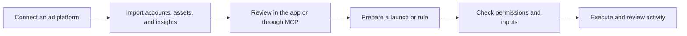

Superlaunch gives your team and AI agents access to advertising data and campaign operations through one workspace. You can use the web application for setup and review, then use an agent for analysis and repeatable tasks.

## The workflow

## Workspaces and accounts

A **workspace** contains your team, connections, brand context, and shared library. An **ad account** belongs to an advertising provider and has its own currency, time zone, and permissions.

In Meta, the delivery hierarchy is **ad account → campaign → ad set → ad**. A creative holds the content used by an ad. Superlaunch stores account IDs as UUIDs; provider campaign, ad-set, ad, and creative IDs are separate identifiers. See [IDs and versions](/concepts/ids-and-versions).

## Data and operations

Insights use imported reporting data. A connected account does not guarantee that today's data is complete. Check the returned reporting period and data-through date.

Direct MCP creation tools support Meta campaigns, ad sets, ads, creatives, duplication, and status changes. Launcher adds a shared creative library, reusable templates, batches, and scheduled launches. Availability depends on your workspace permissions and the enabled capabilities.

Rules evaluate conditions on a schedule or through a manual run. The agent does not need to stay in a conversation for a submitted durable run to continue.

## Access and review

When you authorize an MCP connection, you choose a workspace and scopes. Superlaunch checks your current access when you call a tool. OAuth write access alone does not grant permission to every account or action.

Use **Activity** to inspect tool calls, provider actions, and rule runs. A submitted operation can still be running or can fail after acceptance. Read its final result before reporting success.
